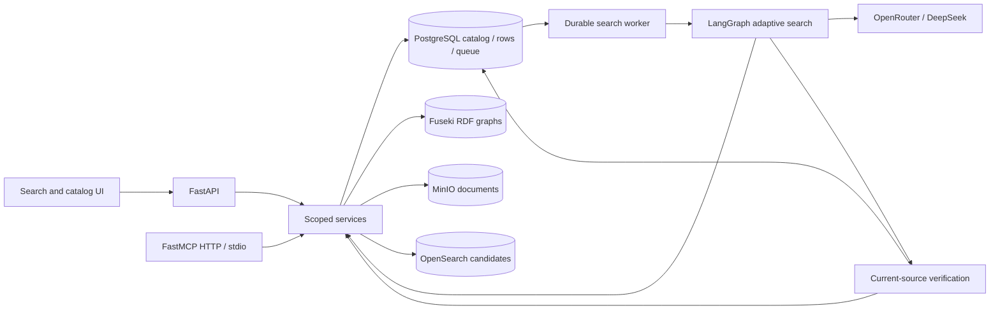

# Architecture

Knowledge Product Manager is a search and catalog application over synthetic enterprise knowledge. RDF is the relationship and governance layer; PostgreSQL and MinIO remain the authoritative content stores. An index hit or graph edge is a route to evidence, not proof of an answer.

## Components and boundaries

| Component | Responsibilities | Implementation |
|---|---|---|
| Web | Search with AI answer and ordinary results; actual source viewer; catalog and governance workspaces | Next.js App Router, React, Framer Motion, GSAP, light red design |
| API | Validated DTOs, persona scope, content cursors, discovery, persisted search control | FastAPI, Pydantic, SQLAlchemy |
| Search worker | Durable claim/heartbeat, adaptive graph, bounded reads, synthesis and verification | LangGraph and PostgreSQL leases |
| Ingestion worker | Source streaming, bounded embedding batches, current index projection | Standalone Python worker, PostgreSQL jobs/advisory ownership |
| PostgreSQL | Catalog JSONB, source rows, identities/roles, run payloads/checkpoints and queue ownership | PostgreSQL 17, Alembic indexes/migrations |
| MinIO | Private text documents and managed SHA-256 metadata | S3-compatible storage; streamed readers |
| Fuseki | Vocabulary and instance named graphs; source-bound governance assertions | Jena 5.4, RDF/SPARQL |
| OpenSearch | Derived lexical/vector content candidates | OpenSearch 2.19, pinned 384-dimensional embedding model |
| MCP | Scoped HTTP and stdio access to shared application services | FastMCP 4 |
| Model gateway | Explicitly configured DeepSeek route, OpenAI-compatible requests | OpenRouter through official OpenAI SDK |

## Domain model

The catalog is restricted to Risk and Compliance; Legal; Technology; Product; Services and Operations; Data and Information; Finance Treasury and Enterprise Tax; People; Third Party and Support; Strategy and Change; Customer and Counterparty.

Domains have a name, description, steward and delegates. Subdomains have a name and description. Sources describe type, system of record and storage location. Knowledge products group sources with ownership, quality and ontology context. Projects have a knowledge product name, status, sponsor, budget and domain/subdomain. Gaps carry coverage, description, tags and data quality issue counts. Roles define current domain access and editable scope. Synthetic business entities, policy instances and document sections link these catalog concepts to actual rows and passages.

Catalog metadata and source contents are distinct: a table description cannot prove an amount; a Policy class cannot govern a business entity. Governance assertions are reified with source asset, version, locator and validity dates. Vocabulary and instances live in separate named graphs under `https://atlas.example/graphs/`.

## Read flow

Discovery retrieves ranked products, tables, documents and definitions. A result opens one content viewer, initially on **Content**, with separate **Context** and **Relationships** tabs. Document sections and SQL rows are cursor/byte bounded; a product exposes a source manifest and a preferred matching source. An answer citation carries a precise locator/version and opens the supporting passage or row. If a source changed, the viewer labels a recorded excerpt as a snapshot and offers current content. It does not silently attribute an old claim to a new document.

Markdown is rendered with react-markdown/GFM. Raw HTML, executable MDX, images and embeds are disabled for retrieved content. React Flow and asynchronous ELK layout provide an interactive bounded ontology neighborhood and accessible list fallback. The graph is not a screenshot or a full estate materialization.

## Scale controls

Entity lookup uses indexed SQL/trigram candidates (bounded to 80) before RDF frontier queries. Graph traversal is bounded to depth 3, 50 nodes, 100 edges and 20 proof paths; each frontier checks current SQL access/source bindings. SQL queries use a managed field registry and typed values, keyset cursors and at most 100 rows. The database connection has a five-second statement timeout.

Content retrieval takes at most 40 candidates from each channel and returns at most 20 current fragments. The schema-v3 content projection uses Lucene HNSW with permission/domain filters inside k-NN, then reciprocal-rank fusion with BM25. Lucene may choose exact pre-filtering for small filtered subsets; this is not a promise of approximate execution for every query. The old exact-score content index is retained locally for rollback. Metadata discovery has its own legacy index.

Ingestion reads MinIO in 32 KiB chunks, splits bounded passages and batches embeddings (64 fragments), catalog pages (100 assets) and SQL pages (200 rows). Per-asset PostgreSQL advisory ownership prevents simultaneous writers. Search admission is shared in SQL: default two active runs per persona, global queue cap 100, two local workers, 45-second renewed leases, 120-second original run deadline, at most 16 source calls and six model attempts. A standalone API deployment should disable the local worker and run search workers separately.

## Deployment and limitations

Compose binds the demo stores to loopback. For a larger deployment, separately scale stateless API and worker processes, tune database pools/queue admission and shard/replica counts against measured workloads, and retain private source-store endpoints. Workers must share PostgreSQL, source services, model configuration and embedding/index versions.

The browser persona selector and static MCP bearer token are demonstration identity, not production authentication. Production requires authenticated principals, OAuth for remote MCP, secret management, TLS, tenant isolation and monitored backups. The model verifier is fallible; passing tests/evaluations does not prove every future answer correct. Managed MinIO SHA metadata is trusted as the source version; row hashes version individual rows rather than a transaction snapshot of an entire dataset. Per-asset index ownership is not a cross-store transaction: a failed incremental ingestion may leave mixed generation fragments until the explicit retry succeeds. Readers still reject stale live versions. See the evaluation artifacts for measured quality and local scale limits.
